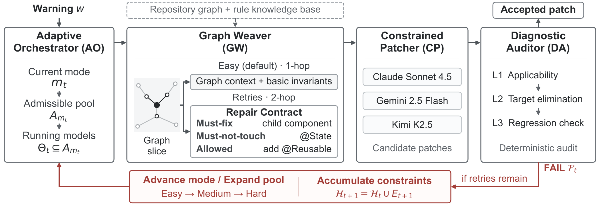

# OH-MAS

OH-MAS (OpenHarmony Multi-Agent System) repairs static-analysis warnings in ArkTS and C/C++ projects using repository dependency graphs, repair contracts, typed diagnostic feedback, and a heterogeneous model pool.

This repository contains the implementation, OH-Bench tasks, repair knowledge, evaluation results, and Docker build instructions.

---

## Overview

Static-analysis linters generate millions of warnings in industrial codebases. Conventional LLM agents leave three decisions implicit: the edit space they explore, what they learn from each rejected attempt, and which model proposes the next fix. OH-MAS (OpenHarmony Multi-Agent System) makes all three explicit:

1. **Repair Contracts** (Graph Weaver) — bound the edit space with must-fix locations, must-not-touch invariants, and rule-specific transformation templates sliced from the project dependency graph.
2. **Typed Diagnostic Feedback** (Diagnostic Auditor) — label every failure as L1 (applicability), L2 (target warning), or L3 (regression), and accumulate them as monotonically tightening constraints across rounds.
3. **Complementarity-aware model pool** (Adaptive Orchestrator + Constrained Patcher) — route each round to a subset of a heterogeneous model pool and widen it as difficulty rises.

The system targets OpenHarmony's two language layers: **ArkTS** (validated by CodeLinter) and **C/C++** (validated by Cppcheck).

---

## Repository Structure

```
OH-MAS/
├── oh-mas-backend/          # Core system (Python)
│   ├── src/oh_mas/          # agents (AO/GW/CP/DA), core, oh_kb, gw_semantic_lib, run
│   └── config/              # Model-pool and component-ablation configurations
├── mini-swe-agent/          # Adapted mini-SWE-agent (CP worker backbone)
├── oh-kb/                   # Knowledge base (rule templates + repair_experiences.json + dependency graphs)
├── dataset/                 # OH-Bench (ArkTS + C/C++) and manual-review subsets
├── docker/                  # Dockerfile.base, Dockerfile (CodeLinter / Cppcheck image), build.sh, fetch/verify scripts for command-line-tools
├── results/                 # Per-instance repair outcomes and oracle-review labels
├── evaluation/              # Comparison studies, paired statistics, and build evidence
└── OH_MAS_appendix.pdf      # Supplementary material
```

---

## Requirements

- Python 3.10+
- Docker (for isolated linter execution; build the image as described below)
- Git, ripgrep
- LLM API access (OpenRouter recommended; see Configuration)

### Hardware


| Component | Minimum | Recommended                    |
| ----------- | --------- | -------------------------------- |
| CPU       | 4 cores | 8+ cores (parallel workers)    |
| RAM       | 16 GB   | 32 GB                          |
| Disk      | 50 GB   | 100 GB (repositories + traces) |

---

## Installation

```bash
# 1. Clone the repository
git clone <REPO_URL> OH-MAS && cd OH-MAS

# 2. Create a virtual environment
python3 -m venv .venv
source .venv/bin/activate

# 3. Install oh-mas-backend and its mini-swe-agent dependency
pip install -e mini-swe-agent/
pip install -e oh-mas-backend/

# 4. Fetch the HarmonyOS command-line-tools 6.0.1.268 (CodeLinter 6.0.240). Huawei distributes the archive
#    behind a developer login (https://developer.huawei.com/consumer/cn/download/), so download it manually,
#    then let the script extract it and verify the tree against docker/command-line-tools.tree.sha256:
bash docker/fetch_command_line_tools.sh /path/to/commandline-tools-linux-x64-6.0.1.268.zip

# 5. Build harmonyrepair:base and harmonyrepair:with-codelinter, matching the runtime configs
bash docker/build.sh harmonyrepair
```

Docker is only needed for `docker_whole` / `docker` execution modes; with `execution_mode: host` and a local CodeLinter/Cppcheck you can skip steps 4-5.

---

## Dataset (OH-Bench)

The `dataset/` directory contains OH-Bench, a repository-level benchmark of **741 real-world warnings** from 39 industrial OpenHarmony repositories:


| File                              | Instances | Language | Purpose                                   |
| ----------------------------------- | ----------- | ---------- | ------------------------------------------- |
| `arkts_dataset_final.json`        | 382       | ArkTS    | Repair and component evaluation                  |
| `cpp_dataset_final.json`          | 359       | C/C++    | Repair and component evaluation                  |
| `arkts_manual_review_subset.json` | 50        | ArkTS    | Manual review / error analysis            |
| `cpp_manual_review_subset.json`   | 50        | C/C++    | Manual review / error analysis            |

Each instance in the main benchmark contains: `instance_id`, alarm metadata (file, line, rule, message), and the buggy repository at a fixed commit. All experiments (including ablations) run on the full 741 instances.

The manual review subsets are 50-instance random samples (`seed=42`) drawn from the full benchmark for qualitative error analysis. They include additional fields — `input_snippet`, `code_lines`, and `category` — to support case-by-case inspection of repair failures.

> **Note:** The 39 source repositories are not included due to size and third-party licensing. Repository snapshots use the dataset's commit_hash field; seven C/C++ entries currently leave this field empty and require source-snapshot identification for an exact rerun. See `dataset/arkts_dataset_final.json` → `commit_hash` field.

---

## Configuration

Copy and edit the example config:

```bash
cp oh-mas-backend/config/exp_p1.yaml oh-mas-backend/config/my_run.yaml
```

Key settings:

```yaml
runtime:
  repositories_root: ../../repositories   # cloned OH repos
  execution_mode: docker_whole            # docker_whole | host

oh_kb:
  provider: graph_explore_mock            # null | local_seed | graph_explore_mock

ao:
  llm_model: openrouter/google/gemini-2.5-flash

gw:
  llm_model: openrouter/anthropic/claude-sonnet-4.5

cp:
  max_parallel_workers: 3
  mode_strategy:
    easy:   [openrouter/anthropic/claude-sonnet-4.5]
    medium: [openrouter/anthropic/claude-sonnet-4.5, openrouter/google/gemini-2.5-flash]
    hard:   [openrouter/anthropic/claude-sonnet-4.5, openrouter/google/gemini-2.5-flash,
             openrouter/moonshotai/kimi-k2.5]
```

Set your API key:

```bash
export OPENROUTER_API_KEY=sk-...
# or
export ANTHROPIC_API_KEY=sk-...
```

---

## Running OH-MAS

### Single instance

Clone the source repository required by the selected dataset task under `runtime.repositories_root` before running. The `run-instance` command loads the task metadata and prepares an isolated workspace at its recorded commit.

```bash
cd oh-mas-backend
PYTHONPATH=src python3 -m oh_mas.run.oh_mas run-instance \
  --config config/my_run.yaml \
  --dataset ../dataset/arkts_dataset_final.json \
  --instance-id OH_0001
```

---

## Evaluation Results

Per-instance repair outcomes (PASS/FAIL, with Pass@1 where available) are documented in [`results/README.md`](results/README.md). `oracle_audit_per_instance.csv` holds the oracle-verdict audit: the 88 DA-accepted patches among the 100 sampled instances, with both annotators' labels (5 false positives, 5.7%; 5 disagreements, Cohen's κ = 0.64).

Paired outcomes, statistics, and method descriptions are in [`evaluation/`](evaluation/README.md).
The controlled matching study includes verdicts, alarms, and statistical results; its analysis implementations are not included.

### Repair Effectiveness

OH-MAS (pool P1, `exp_p1.yaml`) on all 741 instances, against 12 baselines (SPR %):


| System                                 | ArkTS    | C/C++    | Overall  |
| ---------------------------------------- | ---------- | ---------- | ---------- |
| Best direct LLM, 1 att. (GPT-5.5)      | 56.0     | 55.2     | 55.6     |
| Best direct LLM, 3 att. (GPT-5.5)      | 72.8     | 58.2     | 65.7     |
| Best agent, 1 att. (Moatless)          | 58.4     | 54.6     | 56.5     |
| **OH-MAS (P1)**                        | **81.4** | **88.9** | **85.0** |
| Sonnet 4.5, 3 att.                     | 63.9     | 56.3     | 60.2     |
| Moatless, 3 att.                       | 74.1     | 67.1     | 70.7     |
| OH-MAS, Sonnet 4.5 only (same budget)  | 73.6     | 77.7     | 75.6     |

Full baseline rows (Opus 4.5/4.8, Sonnet 4.5, Gemini 2.5 Flash, Kimi K2.5, MiniMax M2.5, Agentless, SWE-agent, Claude Code, OpenCode) are in `arkts_baselines_per_instance.csv`, `cpp_baselines_per_instance.csv`, `baselines_3att_per_instance.csv`, and `gpt55_3att_per_instance.csv`.

### Component Ablations

Component variants are evaluated on all 741 instances; per-instance results are in `results/ablation_per_instance.csv`. Labels such as A1 and A2 are configuration aliases used in the result columns and supplementary documentation:


| Variant                       | Config                | Overall SPR | Δ     |
| ------------------------------- | ----------------------- | ------------- | ------- |
| Full (OH-MAS, P1)             | `exp_p1.yaml`         | 85.0        | —     |
| Single backbone (A1)          | `rev_a1_sonnet.yaml`  | 75.6        | −9.4  |
| A2 (no typed feedback)        | `rev_a2.yaml`         | 57.6        | −27.4 |
| A2′ (free-form, non-cumul.)   | `rev_a2prime.yaml`    | 69.2        | −15.8 |
| A2″ (free-form, cumulative)   | `rev_a2pp.yaml`       | 70.2        | −14.8 |
| A3 (no repair contract)       | `rev_a3.yaml`         | 65.3        | −19.7 |
| A3′ (no knowledge base)       | `rev_a3prime.yaml`    | 76.0        | −9.0  |
| Templates only                | `rev_tpl_only.yaml`   | 74.2        | −10.8 |
| Experiences only              | `rev_exp_only.yaml`   | 81.8        | −3.2  |
| Random routing                | `rev_random.yaml`     | 81.0        | −4.0  |
| Three Sonnet workers          | `rev_sonnet3.yaml`    | 79.5        | −5.5  |

### Model Pools and Cost

Three CP model pools on all 741 instances (`exp_p1/p2/p3.yaml`; per-instance results in `main_P1-P3_per_instance.csv`):


| Pool            | ArkTS | C/C++ | Overall | Pass@1 | $/instance |
| ----------------- | ------- | ------- | --------- | -------- | ------------ |
| P1 (Balanced)   | 81.4  | 88.9  | 85.0    | 54.7   | 0.46       |
| P2 (Cost-Eff.)  | 79.8  | 82.2  | 81.0    | 43.3   | 0.26       |
| P3 (Frontier)   | 78.3  | 86.6  | 82.3    | 54.0   | 0.66       |

---

## Architecture



The figure shows the balanced P1 model pool. [View the vector PDF](docs/images/overview.pdf).

The Adaptive Orchestrator (AO) selects the repair mode and model workers. The Graph Weaver (GW) provides dependency-graph context and repair constraints, and the Constrained Patcher (CP) generates candidate patches. The Diagnostic Auditor (DA) checks patch applicability (L1), target-warning removal (L2), and newly introduced warnings (L3).

An accepted patch ends the repair loop. If no patch passes and a retry remains, typed feedback is retained in the next attempt and the mode advances from Easy to Medium to Hard. Easy uses a one-hop graph slice; Medium and Hard use a two-hop slice.

---

## Knowledge Base (OH-KB)

The `oh-kb/` directory is a unified knowledge base of rule-specialized repair templates and curated repair experiences used by GW (`allowed transformations`). Pre-built dependency graphs (111 graphs, 39 projects, one `{repo}@{commit}/graph_full.json` each) are in `oh-kb/graph_explore/` (`oh_kb.graph_root` in every config; a missing graph directory now raises an error at start-up and a missing project graph logs a warning). These are JSON files organized by linter category:

```
oh-kb/
├── repair_experiences.json     # Curated L3 repair experiences
├── @hw-stylistic/              # HarmonyOS style rules
├── @performance/               # Performance rules
├── cppcheck-logic/             # C++ logic errors
├── cppcheck-safety/            # Memory safety
└── ...
```

Each template file contains `rule_id`, `examples` (buggy/fixed code pairs), and `explanation`.

The OH-KB supports multiple providers (set in config):

- `null` — no KB (ablation A3′)
- `graph_explore_mock` — uses pre-built dependency graphs + oh-kb templates (default)

The KB client implementation and dependency graph construction logic reside in `oh-mas-backend/src/oh_mas/oh_kb/`.

---

## Docker Image

The active build is under `docker/`. `Dockerfile.base` pins its Python 3.11 upstream image by SHA-256 digest and installs Cppcheck 2.17.1; `Dockerfile` adds command-line-tools 6.0.1.268 (CodeLinter 6.0.240). Both stages install Python packages from the supplied lock files. The tool archive is obtained separately and checked before use.

From the repository root, after Installation step 4:

```bash
bash docker/build.sh harmonyrepair
```

This creates `harmonyrepair:base` and `harmonyrepair:with-codelinter`; the latter matches `runtime.docker_image` in the supplied experiment configs. With no argument, the script uses the separate `harmonyrepair-pinned` prefix; select its final image explicitly in your config if you use that default. Building with a prefix updates tags under that prefix.

See [`docker/README.md`](docker/README.md) for build inputs, optional download mirrors, and verification. The original server delivery and successful build evidence are retained in [`evaluation/docker_pinning/`](evaluation/docker_pinning/README.md). This is a verified reconstructed build environment, with the documented historical package difference; it does not claim the rebuilt image has the historical image's identical bytes.

---

## Supplementary Documentation

[System details, prompt templates, and additional evaluation tables](OH_MAS_appendix.pdf) are available in the accompanying PDF.

---

## License

| Component | License | File |
|---|---|---|
| OH-MAS source code | MIT | [`LICENSE`](LICENSE) |
| OH-Bench dataset (`dataset/`) | CC BY 4.0 | [`dataset/LICENSE`](dataset/LICENSE) |
| `mini-swe-agent/` (modified copy of upstream v2.2.8) | MIT, Copyright (c) 2025 Kilian A. Lieret and Carlos E. Jimenez | [`mini-swe-agent/LICENSE.md`](mini-swe-agent/LICENSE.md) |

The upstream mini-swe-agent copyright notice and license text are retained unchanged. The third-party OpenHarmony source repositories referenced by the dataset are not redistributed and remain under their own licenses.
